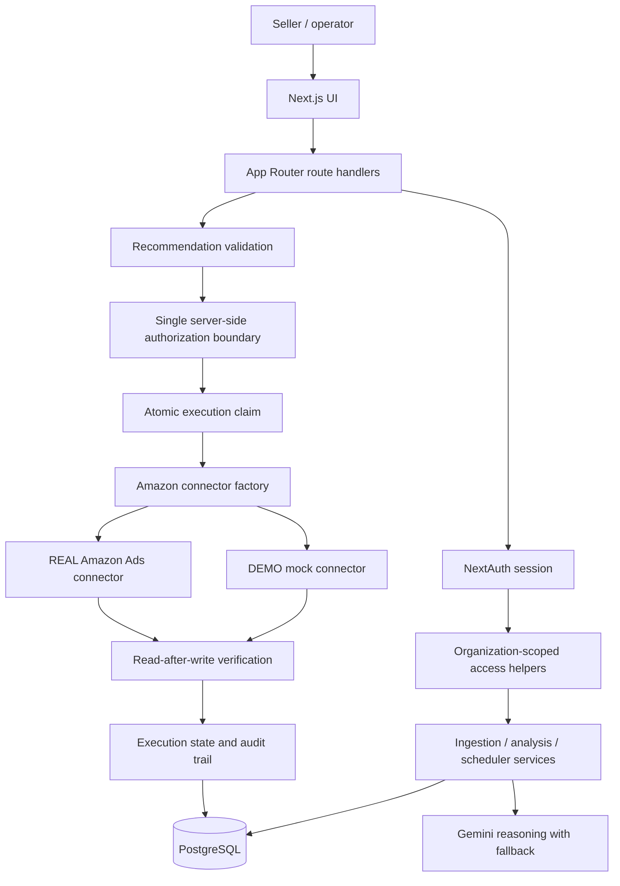

# Architecture

[Back to README](../README.md)

## 1. System boundaries

The repository is a Next.js App Router application. Route handlers form the HTTP boundary; server-side authorization, application services, engines, and connector abstractions implement the domain behavior. Prisma persists application state in PostgreSQL.

The principal code areas are:

| Area | Location | Responsibility |
|---|---|---|
| UI and route handlers | `src/app` | Pages and HTTP endpoints |
| Authentication | `src/lib/auth` | NextAuth configuration and organization-scoped access helpers |
| Amazon integration | `src/lib/amazon` | Connector interface, factory, mock/real implementations, authentication support |
| AI reasoning | `src/lib/ai` | Gemini request/response handling and deterministic fallback |
| Execution engines | `src/lib/engines` | Validation, authorization, execution, rollback, retry, risk and policy logic |
| Application services | `src/lib/services` | Ingestion, scheduler, search-term intelligence and recommendation persistence |
| Persistence | `prisma/schema.prisma`, `src/lib/prisma.ts` | PostgreSQL data model and Prisma client |
| Tests | `scripts` | Safety, enterprise, connector, reporting, Gemini and idempotency checks |

## 2. High-level flow



## 3. Recommendation lifecycle

A recommendation is a persisted proposal, not an instruction to write to Amazon.

Typical human path:

```text
PENDING -> APPROVED -> SUBMITTED -> AMAZON_ACCEPTED -> VERIFIED_SUCCESS
```

The application also records failure and uncertainty states, including `FAILED` and `UNKNOWN`. The schema separately tracks recommendation status, execution state, approval status, and approval source.

The recommendation action endpoint accepts `APPROVE`, `REJECT`, `EXECUTE`, `IGNORE`, `LOCK`, and `ROLLBACK`. Approval/rejection uses a conditional database update so concurrent decisions cannot both win. Human execution requires an `APPROVED` recommendation. Autopilot-policy execution requires a `PENDING` recommendation and an account automation level that permits it.

## 4. Authorization and execution

The execution engine calls deterministic recommendation validation and then the central authorization boundary before it obtains a connector and attempts a write.

The authorization boundary checks, among other things:

- The Amazon account exists.
- The account belongs to the expected organization when an organization ID is supplied.
- The account is active.
- The account automation pause switch is not enabled.
- The action type is in the supported write-action set.
- Bid changes remain within the hard 15% ceiling and the account's configured limit (whichever is stricter).
- Budget changes remain within the account's configured budget limit.
- The approval source and automation level permit the requested execution.
- Referenced entities belong to the correct account.

The engine then conditionally changes the execution state to `SUBMITTED` before sending the connector write. This is an atomic claim intended to prevent concurrent callers from executing the same recommendation twice.

For supported changes, the engine reads the value back through the connector and verifies it. It records request metadata and before/after information for audit and recovery.

**Important distinction:** model-generated confidence and risk are informational. They do not replace deterministic authorization and do not independently grant permission to execute.

## 5. Connector selection

`getAmazonConnector` selects between:

- `DEMO`: the shared mock connector used for demo behavior and fallback.
- `REAL`: the real connector, selected for an account marked live when the required account credentials and profile configuration are available.

A live account must not silently execute against the mock connector. The execution and rollback paths explicitly reject a live account when the selected connector is not REAL.

Connector credentials are associated with the account record in the current schema. See [Security](SECURITY.md) for handling requirements.

## 6. Autopilot scheduler

The scheduler's cycle is documented in code as:

```text
SYNC -> ANALYZE -> RECOMMEND -> AUTHORIZE -> EXECUTE -> VERIFY -> MEASURE
```

The worker:

1. Claims an eligible job using a conditional update and worker lock.
2. Synchronizes account data; it stops the cycle if sync fails rather than continuing with stale data.
3. Classifies search terms and generates deduplicated recommendations.
4. Analyzes campaign keywords and creates eligible bid recommendations.
5. Applies the configured automation policy to eligible pending bid recommendations.
6. Records cycle/job outcomes and timing.

The cron route is POST-based (GET delegates to POST) and requires an exact `Authorization: Bearer <CRON_SECRET>` header. It scopes accounts to `AUTOPILOT_ORGANIZATION_ID`, retries due jobs, and avoids starting a new cycle for an account with an unresolved retry.

The scheduler has a five-minute stale-lock threshold, up to three retries, and a per-cycle automatic execution cap of five, as defined in the current scheduler source. These are implementation defaults, not a substitute for monitoring.

## 7. Search-term intelligence and idempotency

Search-term classifications are deterministic. Gemini may provide a recommendation explanation and risk/confidence assessment, but it is instructed not to override the classification or invent metrics. A deterministic fallback is used when Gemini is absent, times out, or returns an invalid response.

Search-term recommendation persistence is designed to be idempotent:

- A recommendation is identified using account/search-term idempotency data.
- Only a row that remains `PENDING` in recommendation status, execution state, and approval status may be refreshed.
- The refresh is a guarded conditional update.
- Concurrent creation is resolved by a database unique constraint on `(amazonAccountId, idempotencyKey)`; the losing writer re-reads the winning row.
- Non-unique database errors are re-thrown rather than hidden.

The unique constraint migration requires a duplicate preflight before production rollout; see [Deployment](DEPLOYMENT.md).

## 8. Rollback

Rollback is not a blind inverse operation. It locates the latest successful non-rollback audit event for the recommendation and checks organization ownership, account state, kill switch, rollback metadata, and whether the current value still matches the value written by the original execution. If the value has drifted, rollback stops rather than overwriting a newer change.

A rollback is claimed before the connector write and is verified by reading the restored value back. Rollback is not available for every action or every historical record; the audit record must contain valid rollback information.

## 9. Data model overview

The Prisma schema includes these main groups:

- **Tenant/account:** `Organization`, `AmazonAccount`
- **Catalog and ads:** `Product`, `Campaign`, `Keyword`, `SearchTerm`
- **Performance:** `PerformanceMetric`
- **Decision and execution:** `Recommendation`, `AuditLog`
- **Background processing:** `SyncJob`
- **Learning/experimentation:** `Experiment`, `LearningOutcome`

Use `prisma/schema.prisma` as the source of truth for fields, relations, enums, and indexes.

## 10. Design constraints

- Keep AI outside the authorization boundary.
- Route every Amazon write through deterministic validation and authorization.
- Do not let a live account silently fall back to mock writes.
- Prefer conditional updates and unique constraints for concurrency-sensitive transitions.
- Verify remote writes rather than assuming an accepted request means the target state changed.
- Preserve audit history and stop rollback when the current value has drifted.
